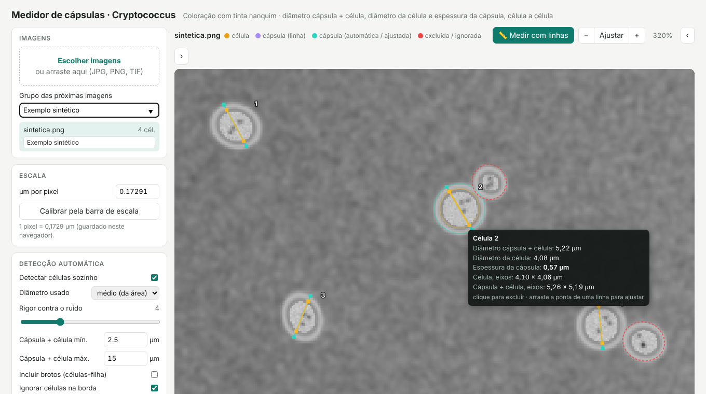

# Medidor de cápsulas · *Cryptococcus*

**Site:** https://medidor-capsulas.vercel.app

Ferramenta para medir, célula a célula, o **diâmetro da célula**, o **diâmetro cápsula + célula**, a **espessura da cápsula** e o **volume capsular** de *Cryptococcus* em imagens de microscopia com tinta nanquim. Ela detecta as células sozinha e permite conferir e corrigir cada medida à mão, como no ImageJ.

## O que ela faz

- **Detecção automática:** encontra as células, separa as que estão encostadas, deixa de fora os brotos e as células cortadas pela borda, e mede as bordas da cápsula e da célula com precisão abaixo de 1 pixel.
- **Conferência e correção:** cada célula aparece com duas linhas sobrepostas, uma para a célula e outra para a cápsula + célula. Ao passar o mouse aparecem os valores, e arrastando a ponta de uma linha a medida é corrigida. A tabela e o gráfico atualizam na hora.
- **Medição manual:** o modo "📏 Medir com linhas" funciona como no ImageJ: uma linha de borda a borda da célula e depois outra da cápsula + célula.
- **Zoom de verdade:** a roda do mouse amplia até 6000%. O botão direito, ou espaço + arrastar, move a imagem.
- **Grupos e gráficos:** cada imagem recebe um grupo (cepa, condição, tempo). O site mostra um box plot por grupo com teste de Mann-Whitney ou Kruskal-Wallis.
- **Planilha Excel:** as colunas são escolhidas pelo usuário. Os volumes vêm com as mesmas fórmulas da planilha do laboratório, e é possível gerar uma aba por grupo.
- **Privacidade:** tudo roda no navegador. As imagens **não são enviadas** para nenhum servidor.
- Aceita **TIF** (8 e 16 bits, inclusive OME-TIFF de microscópio), **PNG** e **JPG**.

## Documentação

👉 **[Como funciona, passo a passo](docs/COMO-FUNCIONA.md)**: uso, o método de detecção com figuras de cada etapa, as fórmulas, as limitações e um mapa do código.

## Arquivos

| Arquivo | O que é |
|---|---|
| `index.html` | O site inteiro: interface, análise de imagem e exportação (HTML + CSS + JavaScript, sem framework) |
| `lib/UTIF.js`, `lib/pako.min.js` | Leitura de arquivos TIF ([UTIF.js](https://github.com/photopea/UTIF.js), MIT; [pako](https://github.com/nodeca/pako), MIT/Zlib) |
| `lib/xlsx.full.min.js` | Geração do arquivo Excel ([SheetJS Community Edition](https://sheetjs.com), Apache-2.0) |
| `docs/` | Documentação e figuras. As figuras usam uma imagem **sintética**, gerada por computador, e não dados de pesquisa |

## Publicação

É um site estático, sem etapa de build. Na Vercel, basta importar o repositório e manter as configurações padrão. Cada envio para a branch `main` atualiza o site.

## Sobre o desenvolvimento

O código foi escrito com assistência de IA (Claude, da Anthropic), a partir das necessidades do laboratório e de testes com imagens reais de microscopia. O método foi comparado com medições manuais feitas no ImageJ. Antes de usar em publicações, recomenda-se validar com imagens do próprio estudo (veja "Validação" na documentação).
