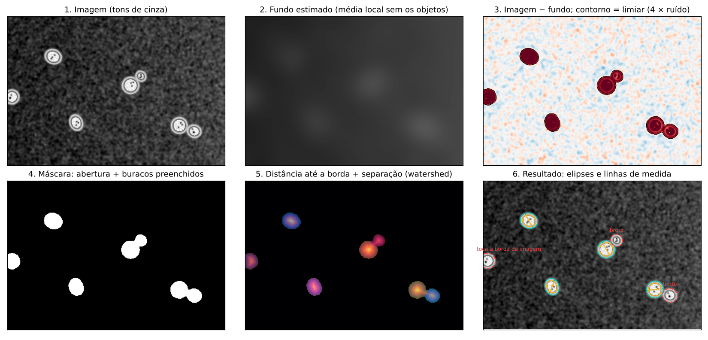
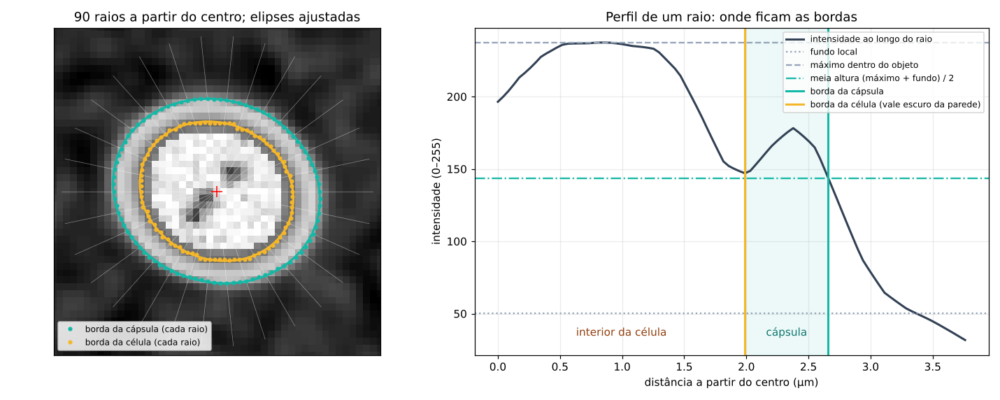
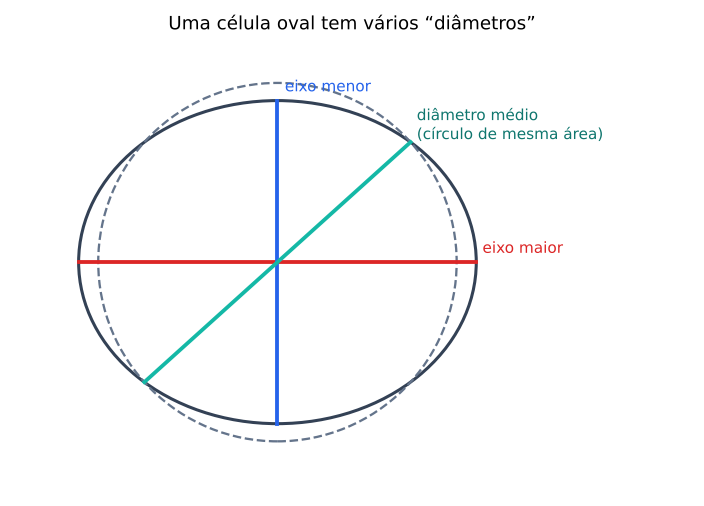

# Como funciona o Medidor de cápsulas

Este documento explica o site em linguagem simples e com detalhes técnicos suficientes para que outra pessoa entenda, confira ou reproduza o método. As figuras usam uma **imagem sintética**, gerada por computador para imitar uma imagem de microscopia com tinta nanquim. Nenhum dado de pesquisa aparece aqui.

**Sumário**

1. [A ideia em poucas palavras](#1-a-ideia-em-poucas-palavras)
2. [Usando o site](#2-usando-o-site)
3. [Escala e unidades](#3-escala-e-unidades)
4. [A detecção automática, etapa por etapa](#4-a-detecção-automática-etapa-por-etapa)
5. [Como as bordas são encontradas](#5-como-as-bordas-são-encontradas)
6. [Qual "diâmetro"? Médio, eixo maior e eixo menor](#6-qual-diâmetro-médio-eixo-maior-e-eixo-menor)
7. [Linhas na tela, ajustes e medição manual](#7-linhas-na-tela-ajustes-e-medição-manual)
8. [Cálculos e planilha](#8-cálculos-e-planilha)
9. [Comparação entre grupos (gráfico e teste)](#9-comparação-entre-grupos-gráfico-e-teste)
10. [Validação](#10-validação)
11. [Limitações conhecidas](#11-limitações-conhecidas)
12. [Mapa do código](#12-mapa-do-código)
13. [Glossário](#13-glossário)

---

## 1. A ideia em poucas palavras

Na coloração com tinta nanquim, o fundo fica cinza e granulado. A cápsula de *Cryptococcus* aparece como um **halo claro** em volta da célula, e a **parede celular** aparece como um **anel mais escuro** entre o halo e o interior claro da célula.

O site faz no computador o que uma pessoa faz no ImageJ:

1. **Acha** onde estão as células, ignorando o granulado do fundo.
2. **Separa** as células que estão encostadas e reconhece os brotos.
3. **Mede**, para cada célula, onde termina o halo (borda da cápsula) e onde fica o anel escuro (borda da célula), olhando em 90 direções diferentes.
4. **Ajusta uma elipse** a cada borda e calcula os diâmetros, a espessura e os volumes.

Tudo acontece no navegador de quem usa. As imagens não saem do computador.

## 2. Usando o site

1. **Grupo:** antes de enviar as imagens, escreva o grupo em "Grupo das próximas imagens", por exemplo `H99 30 °C 24 h`. Depois também dá para mudar o grupo de cada imagem na lista.
2. **Imagens:** clique em "Escolher imagens" ou arraste os arquivos. Dá para enviar várias de uma vez, em TIF, PNG ou JPG.
3. **Conferir:** cada célula aceita aparece com um número e duas linhas. A **amarela** é o diâmetro da célula e a **verde-água** é o diâmetro cápsula + célula. Passe o mouse para ver os valores e o contorno detectado. As células ignoradas (brotos, cortadas pela borda, formas irregulares) aparecem com contorno **vermelho tracejado**, e o motivo aparece ao passar o mouse.
4. **Corrigir:**
   - **Ajustar uma medida:** arraste a ponta de uma linha.
   - **Excluir uma célula:** clique nela.
   - **Medir uma célula que não foi encontrada:** use "📏 Medir com linhas".
   - **Desfazer:** Ctrl+Z desfaz o último ajuste ou a última medida.
5. **Navegar:** a roda do mouse dá zoom; o botão direito, ou espaço + arrastar, move a imagem. As teclas `+`, `−` e `0` aumentam, diminuem e ajustam o zoom à tela. As setas ← → trocam de imagem.
6. **Resultados:** escolha as colunas em "Colunas da tabela e da planilha". Use "⬇ Baixar planilha (Excel)" ou "Copiar tabela". O gráfico "Comparar grupos" fica no fim da página.

As preferências (escala, colunas, opções) ficam guardadas no navegador.

## 3. Escala e unidades

- A escala padrão é **57,8343 pixels = 10 µm**, ou seja, 0,17291 µm por pixel. Ela pode ser mudada no campo "µm por pixel" ou com "Calibrar pela barra de escala": você clica nas duas pontas de uma barra (ou de qualquer comprimento conhecido) e digita o tamanho.
- Se o arquivo TIF trouxer o tamanho do pixel nos metadados (OME-TIFF, campo `PhysicalSizeX`) e esse valor for diferente da escala em uso, o site avisa e oferece usar o valor do arquivo.
- **A escala só vale para a resolução original da imagem.** Prints de tela ou fotos enviadas pelo WhatsApp mudam o tamanho dos pixels. Use sempre o arquivo original do microscópio.
- Os limites de tamanho da detecção ("Cápsula + célula mín./máx.") são guardados em pixels e mostrados na unidade atual.

## 4. A detecção automática, etapa por etapa

**Etapa 0, leitura.** A imagem é convertida para tons de cinza. Os TIF de 16 bits são lidos com todos os níveis de intensidade. O contraste é esticado entre os percentis 0,2% e 99,8%, para que imagens de câmeras diferentes fiquem na mesma escala de 0 a 255. Antes de tudo, a imagem passa por uma suavização leve: um filtro de média 3×3, aplicado duas vezes, que tira o ruído de pixel isolado.

**Etapa 1, fundo.** O fundo de tinta nanquim não é uniforme: há granulado e às vezes um gradiente de iluminação. O site estima o fundo com uma **média local grande**, numa janela de 41×41 pixels aplicada duas vezes. Na primeira estimativa, as células puxam a média para cima. Por isso, na segunda passada, os pixels muito claros (mais de 3× o ruído acima do fundo) são trocados pelo valor do fundo antes de calcular a média de novo (figura, painel 2).

**Etapa 2, ruído e limiar.** O site subtrai o fundo da imagem e mede o tamanho do granulado com o **desvio mediano absoluto (MAD)**, uma medida de espalhamento que não é afetada pelas células. Um pixel só conta como "objeto" se estiver **mais de 4 vezes o ruído** acima do fundo. Esse 4 é o controle **"Rigor contra o ruído"**: aumentar elimina detecções falsas, e diminuir encontra células mais fracas. É por isso que o granulado não vira círculos falsos: o limiar se adapta ao ruído de cada imagem (painel 3).

**Etapa 3, máscara.** A máscara (preto e branco) passa por uma **abertura** 3×3, que apaga pontinhos isolados e pontes finas. Depois, os **buracos internos são preenchidos**, para que a célula inteira, com o interior, vire um objeto só (painel 4). Os objetos muito pequenos ou muito grandes para o intervalo de tamanho são descartados, assim como os que não têm contraste suficiente: o ponto mais claro do objeto precisa ficar acima do fundo pelo menos o dobro do limiar (e no mínimo 6× o ruído).

**Etapa 4, separar células encostadas.** Para cada pixel do objeto, o site calcula a **distância até a borda** (transformada de distância). O centro de cada célula fica com a maior distância, como o topo de um morro. Cada topo vira uma "semente", desde que tenha pelo menos 40% da altura do maior topo (e no mínimo 2,5 pixels) e não esteja colado em outro. Depois, o objeto é dividido entre as sementes pelo método **watershed**: imagine encher de água a partir de cada topo e marcar onde as águas se encontram (painel 5).

**Etapa 5, medir.** Em cada célula separada, o site lança 90 raios e localiza as bordas (próxima seção). Depois ajusta uma elipse a cada borda (painel 6).

**Etapa 6, filtros de qualidade.** Uma célula é aceita somente se:
- a borda da cápsula foi encontrada em **pelo menos 40% dos raios**. Os raios que esbarram numa célula vizinha não contam;
- a elipse se ajusta bem aos pontos: o erro médio (RMS) não passa de 1,2 pixel ou de 12% do raio;
- a forma não é alongada demais: o eixo maior tem no máximo 2,2 vezes o eixo menor;
- a borda da célula foi encontrada, fica **dentro** da cápsula e tem pelo menos 30% do tamanho dela;
- o diâmetro está dentro do intervalo de tamanho;
- não encosta na borda da imagem, se "Ignorar células na borda" estiver ligado;
- não é um **broto**: num grupo de células encostadas, uma célula cuja vizinha tem área pelo menos 25% maior é considerada célula-filha. Os brotos ficam de fora, a menos que "Incluir brotos" esteja ligado.

## 5. Como as bordas são encontradas

A partir do centro da célula saem **90 raios**, um a cada 4°. Ao longo de cada raio, a intensidade é lida a cada 0,25 pixel, com interpolação bilinear entre os pixels vizinhos. O gráfico à direita mostra como é esse perfil.

- **Borda da cápsula:** é onde a intensidade cai até a **meia altura** entre o ponto mais claro da célula e o fundo local. É o critério clássico de "largura a meia altura", que não depende do contraste de cada imagem. A posição é calculada entre duas amostras (interpolação linear), com precisão abaixo de 1 pixel.
- **Borda da célula:** é o **vale escuro da parede celular**, o ponto mais escuro entre o interior claro e o halo da cápsula. O site procura esse vale entre 40% do raio da cápsula e 1,2 pixel para dentro da borda da cápsula, e refina a posição com uma parábola pelos três pontos em volta do mínimo. O vale só conta se for de fato mais escuro que o interior e que o halo.
- **Raios que encostam em outra célula** são descartados. Assim, o ponto de contato entre duas células não distorce a medida.

**Ajuste da elipse.** Os pontos de borda de todos os raios são ajustados a uma **elipse por mínimos quadrados**, usando a equação geral de uma cônica. Antes do ajuste, saem os pontos muito longe da distância típica até o centro, ou seja, fora de 0,6 a 1,45 vez a mediana. Depois do ajuste, os pontos com erro grande (mais de 2,5 vezes o erro mediano) são retirados e a elipse é ajustada de novo, até 3 vezes. Isso evita que uma mancha ou um grânulo puxe a medida.

## 6. Qual "diâmetro"? Médio, eixo maior e eixo menor

As células são levemente ovais. Por isso, uma linha de borda a borda tem comprimentos diferentes conforme a direção em que é traçada. O campo "Diâmetro usado" oferece três opções:

| Opção | O que é | Fórmula (semi-eixos *a* ≥ *b*) |
|---|---|---|
| **Médio (da área)**, o padrão | diâmetro de um círculo com a mesma área da elipse | 2·√(*a*·*b*) |
| **Eixo maior** | a linha mais comprida possível | 2·*a* |
| **Eixo menor** | a linha mais curta possível | 2·*b* |

O diâmetro médio **não depende do ângulo** em que a linha seria traçada. Por isso a mesma célula sempre dá o mesmo valor. Já numa medição manual, o resultado varia com a direção escolhida, entre o eixo menor e o eixo maior. Como o volume usa o diâmetro ao cubo, essa escolha pesa bastante no volume capsular. **O importante é usar o mesmo critério em todo o estudo.**

## 7. Linhas na tela, ajustes e medição manual

- **Linhas automáticas:** para cada célula, a linha verde-água tem exatamente o comprimento do diâmetro cápsula + célula escolhido, e as pontas ficam sobre a elipse detectada. A linha amarela, com o comprimento do diâmetro da célula, fica **sobreposta**, no mesmo eixo. Quando há uma célula vizinha encostada, o site escolhe a direção mais perpendicular a ela, para a linha não passar pelo ponto de contato. É o mesmo cuidado que se tem na medição manual.
- **Ajuste:** arrastar a ponta de qualquer linha transforma a célula numa medida **"automática ajustada"**. O valor passa a ser o comprimento das linhas, a célula **mantém o seu número** e a tabela e o gráfico atualizam na hora. Os ajustes continuam valendo se a análise for refeita.
- **Medição manual ("📏 Medir com linhas"):** primeiro se traça a linha da **célula**, depois a da **cápsula + célula**. Dá para arrastar ou clicar numa borda e depois na outra. Enquanto se traça, o comprimento aparece em µm.
- **Prioridade:** uma medida manual ou ajustada substitui a detecção automática no mesmo lugar.

## 8. Cálculos e planilha

Para cada célula, com *d* = diâmetro da célula e *D* = diâmetro cápsula + célula:

| Coluna | Cálculo |
|---|---|
| Diâmetro da célula | *d* |
| Diâmetro cápsula + célula | *D* |
| Diâmetro cápsula | *D* − *d*, de modo que "Diâmetro célula+cápsula = Diâmetro da célula + Diâmetro cápsula", como na planilha do laboratório |
| Espessura da cápsula | (*D* − *d*) / 2 |
| Volume da célula | (4 · 3,14 / 3) · (*d*/2)³ |
| Volume célula + cápsula | (4 · 3,14 / 3) · (*D*/2)³ |
| Volume capsular | Volume célula + cápsula − Volume da célula |
| Média do volume capsular | média do volume capsular das células do grupo |

- O π = 3,14 foi mantido igual ao da planilha do laboratório, para os resultados serem comparáveis.
- Os diâmetros são arredondados para 3 casas decimais, como no ImageJ, e os volumes são calculados a partir desses valores.
- **Excel:** as colunas são as que estiverem marcadas. Os volumes vão como **fórmulas** do Excel, então corrigir um diâmetro na planilha recalcula tudo. Se uma coluna de que a fórmula depende estiver desmarcada, vai o valor já calculado. A opção "uma aba por grupo" cria uma aba por condição, com o título "Grupo - N= n".
- **Copiar tabela:** copia em dois formatos ao mesmo tempo. O formato de tabela (HTML, com o valor numérico de cada célula) é o que o Excel usa ao colar, e por isso cada número cai numa célula mesmo que o "Texto para Colunas" com vírgula esteja ativo. O texto comum, separado por tabulação, serve para colar em outros programas.

## 9. Comparação entre grupos (gráfico e teste)

- **Box plot:** a caixa vai do 1º ao 3º quartil (calculados por interpolação linear), a linha do meio é a mediana e as hastes vão até 1,5 vez o intervalo interquartil. Cada ponto é uma célula. Clicar num ponto abre a imagem daquela célula.
- **Teste:** com 2 grupos, Mann-Whitney bilateral (aproximação normal); com 3 ou mais, Kruskal-Wallis. Os dois usam correção para empates, e o valor de p vem da distribuição qui-quadrado. Os resultados foram conferidos contra o pacote `scipy` do Python.
- **Atenção:** o teste trata cada célula como independente. As células de uma mesma cultura não são independentes, então esse teste serve para **explorar** os dados. A estatística de uma publicação deve considerar as réplicas biológicas.

## 10. Validação

A forma recomendada de validar é comparar o site com a medição manual (ImageJ) **nas mesmas células**:

1. Escolher imagens de condições diferentes e medir manualmente umas 50 a 100 células.
2. Rodar o site nas mesmas imagens, usando a mesma escala.
3. Comparar as medidas célula a célula, por exemplo com um **gráfico de Bland-Altman** (diferença × média) e um **coeficiente de correlação intraclasse**.
4. Para efeito de comparação, vale também medir a variação **entre duas pessoas** medindo à mão. A ferramenta é adequada se a diferença dela para o manual for da mesma ordem que a diferença entre duas pessoas.

Para ajudar a parear as medidas, a tabela e a planilha trazem o **número de cada célula** e o nome da imagem. Os eixos maior e menor também podem ser incluídos.

## 11. Limitações conhecidas

- **Halo fraco ou interrompido:** se em algum trecho a cápsula ficar quase da cor do fundo, a célula pode não ser detectada ou pode ser medida pelo contorno errado. Nesses casos, aumente o zoom, confira e, se precisar, meça com linhas.
- **Aglomerados grandes**, com muitas células sobrepostas, podem não ser separados corretamente. Os brotos muito pequenos podem se juntar à célula-mãe.
- **Tipo de imagem:** o método foi pensado para campo claro com tinta nanquim (halo claro, parede escura). Outras colorações ou contrastes, como fluorescência ou contraste de fase, não foram testadas.
- **Escala:** a precisão em µm depende da calibração. Uma diferença de 2% na escala vira cerca de 6% no volume.
- **Volume:** a fórmula supõe que a célula é uma esfera com o diâmetro escolhido. Para células ovais, o resultado depende do critério de diâmetro (seção 6).

## 12. Mapa do código

Todo o site está em `index.html`, dividido em dois blocos `<script>`:

**Núcleo de análise** (`<script id="core">`, não depende da interface):

| Função | O que faz |
|---|---|
| `boxBlur` | média móvel separável, usada na suavização e no fundo |
| `otsu`, `morph`, `fillHoles`, `labelComps` | operações básicas: limiar de Otsu (não usado na detecção atual), abertura, preenchimento de buracos, componentes conectados |
| `chamferDT` | transformada de distância (chanfro 3-4) |
| `analyzeV2` | detecção completa: fundo, ruído, máscara, sementes, watershed, raios, elipses, filtros e brotos |
| `fitEllipse`, `fitRobust`, `ellipseRadius` | ajuste de elipse por mínimos quadrados e versão com rejeição de pontos ruins |
| `stretchToU8` | conversão de 8 ou 16 bits para 0 a 255 por percentis |

**Interface** (segundo `<script>`):

| Função | O que faz |
|---|---|
| `decode` | lê os arquivos, incluindo TIF via UTIF.js e a escala dos metadados OME |
| `allCells`, `numbering` | junta as células automáticas e as manuais, aplica o critério de diâmetro, cria as linhas e numera |
| `ellipseLine`, `overlayLine` | linhas de medida sobre a elipse (cápsula) e sobreposta (célula) |
| `draw`, `zoomAt`, `fitView` | desenho na tela, zoom e movimento |
| `hitEndpoint`, `beginEdit`, `recompute` | arrastar as pontas das linhas e recalcular |
| `COLS`, `renderTable`, `tableData`, `tableHTML` | colunas escolhidas, tabela na tela e cópia para o Excel |
| `buildXlsx` | geração do arquivo Excel com fórmulas |
| `collectGroups`, `summary`, `kruskal`, `renderCompare` | estatística e gráfico por grupo |

Os parâmetros principais estão no objeto `S.p`, no início do segundo script. São eles o rigor (`sens`), os tamanhos mínimo e máximo (`minD`, `maxD`, em pixels), a inclusão de brotos, as células na borda e o critério de diâmetro (`metric`).

## 13. Glossário

- **Máscara:** imagem em preto e branco que marca quais pixels pertencem a objetos.
- **Limiar:** valor de corte. Acima dele, o pixel é considerado objeto.
- **MAD (desvio mediano absoluto):** medida de quanto os valores variam. Diferente do desvio padrão, ela não é afetada por alguns valores extremos, como as células.
- **Abertura (morfologia):** encolher e depois crescer a máscara em 1 pixel, o que apaga pontinhos e pontes finas.
- **Transformada de distância:** para cada pixel do objeto, a distância até a borda mais próxima.
- **Watershed ("divisor de águas"):** método que divide um objeto em regiões a partir de sementes, como água subindo de vários poços até se encontrar.
- **Meia altura:** o ponto em que a intensidade está exatamente no meio entre o valor máximo e o fundo. É um jeito padronizado de definir onde uma borda borrada "termina".
- **Subpixel:** posição calculada com mais precisão que o tamanho de 1 pixel, por interpolação.
- **Mínimos quadrados:** ajuste que escolhe a curva (aqui, a elipse) que minimiza a soma dos quadrados das distâncias aos pontos.
- **RMS:** raiz da média dos quadrados dos erros. Indica, em pixels, o quanto os pontos se afastam da elipse.
